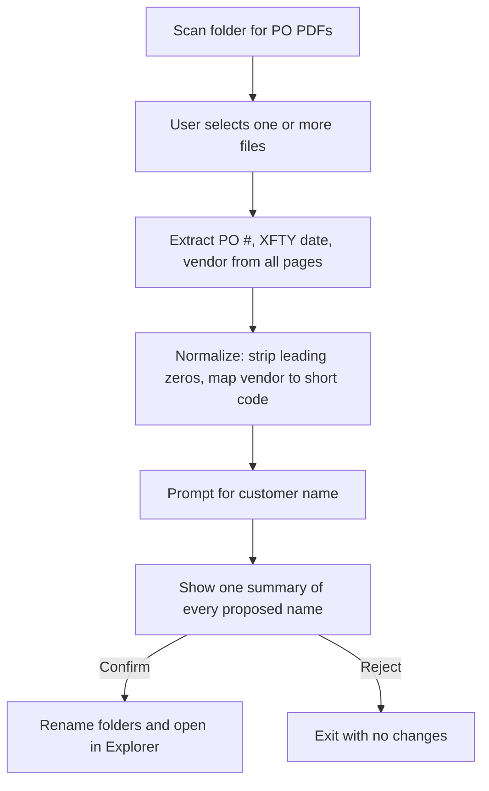

# FPO Receiving Automation

**A Python command-line tool that turns a manual purchase-order (PO) receiving step into one command and one confirmation.**

Built and used to standardize how received FPO (PO) files are named and filed. This repository is a public-safe version: all vendor and customer names are placeholders.

> **Status:** v1, working CLI (Windows). Public-safe edition of a tool built for a real receiving workflow.
> **My role:** Problem definition, requirements, design, implementation, and testing. *(Edit to match what you actually did.)*

---

## 1. The problem

Receiving a PO meant opening each PDF, finding three values (PO number, XFTY date, vendor), and typing them by hand into a folder name.

- **Slow:** the same lookup and retyping for every file.
- **Error-prone:** a mistyped digit or date creates a folder nobody can find later.
- **Inconsistent:** different people formatted names differently, which breaks any downstream search or process that depends on the name.

## 2. Goal and non-goals

| Goal | Non-goal (deliberately out of scope for v1) |
|---|---|
| One consistent folder name per PO, generated rather than typed | ERP or database integration |
| One human confirmation for the whole batch | Reading scanned or image-only PDFs (no OCR) |
| Works on a standard Windows machine with no server | Editing or deleting the PDFs themselves |

**Naming standard produced:** `PO {Clean_PO}-{Customer}-{Vendor}-{XFTY_Date}`
Example: `PO 9710-CUSTOMER A-VENDOR A-MM-DD-YYYY`

## 3. How it works



**Details**
- **Discovery:** finds PDFs matching `*PO*[0-9]*.pdf`.
- **Extraction:** reads every page of each PDF in one pass.
- **Clean PO number:** `0000009710` becomes `9710`.
- **Vendor short codes:** raw vendor names are mapped through a dictionary you control.
- **Safety gate:** nothing is renamed until you approve the summary.

## 4. Key design decisions and trade-offs

| Decision | Why | Trade-off accepted |
|---|---|---|
| Local CLI, not a web app | Fastest path to value; no hosting, approvals, or infrastructure | Windows-only; no shared UI |
| One batch confirmation, not per-file prompts | Keeps the speed benefit when processing many files | The user must actually read the summary, so it lists every proposed name in full |
| Vendor mapping in an editable dictionary | Business owners can add vendors without touching logic | Unmapped vendors need manual upkeep |
| Rename only after approval; PDFs untouched | A wrong rename is the main risk; this makes it recoverable | One extra step for the user |
| Public edition uses placeholders | No proprietary supplier or customer data in a public repo | Sample output is illustrative, not real |

## 5. Risks and mitigations

| Risk | Mitigation |
|---|---|
| PO layout changes and extraction picks the wrong value | Extracted values are shown in the confirmation summary before any change |
| Scanned PDFs have no text to extract | Out of scope in v1; OCR fallback is on the roadmap |
| Vendor not in the mapping | Planned: flag unmapped vendors in the summary instead of passing through silently |
| Duplicate or conflicting folder names | Planned: collision check before renaming |

## 6. Success metrics

Measure these before publishing and replace the placeholders. **Delete any row you cannot back with real data.**

| Metric | Manual process | With this tool |
|---|---|---|
| Time to process one PO | `[measure]` | `[measure]` |
| Time to process a batch of `[N]` POs | `[measure]` | `[measure]` |
| Naming errors found per `[N]` POs | `[measure]` | `[measure]` |

## 7. Run it

**Requirements:** Python 3.x and `pypdf` (or `PyPDF2`)

```cmd
pip install pypdf
python rcvd_fpo_public.py
```

**Configure vendors:** edit `VENDOR_MAPPING` in `rcvd_fpo_public.py`.

```python
VENDOR_MAPPING = {
    "RAW VENDOR NAME A": "VENDOR A",
    "RAW VENDOR NAME B": "VENDOR B",
}
```

## 8. Roadmap (prioritized by risk reduction and effort)

| Priority | Item | Why now |
|---|---|---|
| 1 | Warn on unmapped vendors; check for folder-name collisions | Closes the two most likely silent failures |
| 2 | Automated tests with `pytest` on sample PDFs | Lets changes ship safely |
| 3 | OCR fallback (Tesseract) for scanned PDFs | Expands coverage once the core is trusted |
| 4 | Simple API or UI for non-technical users | Only worth it if adoption justifies it |

## 9. What this project demonstrates

- Turning a vague operational pain into scoped requirements, with explicit non-goals.
- Choosing the smallest solution that works, and documenting the trade-offs.
- Designing a human checkpoint where an automated mistake would be costly.
- Sequencing a roadmap by risk, not by what is interesting to build.

## Privacy

All vendor, supplier, and customer names in this repository are synthetic placeholders (`VENDOR A/B/C`, `CUSTOMER A/B/C`, `MM-DD-YYYY`). No proprietary data is included.

## Author

**[Your Name]**, Technical Program Manager focus (operations, supply chain, automation) · [LinkedIn] · [Email]
